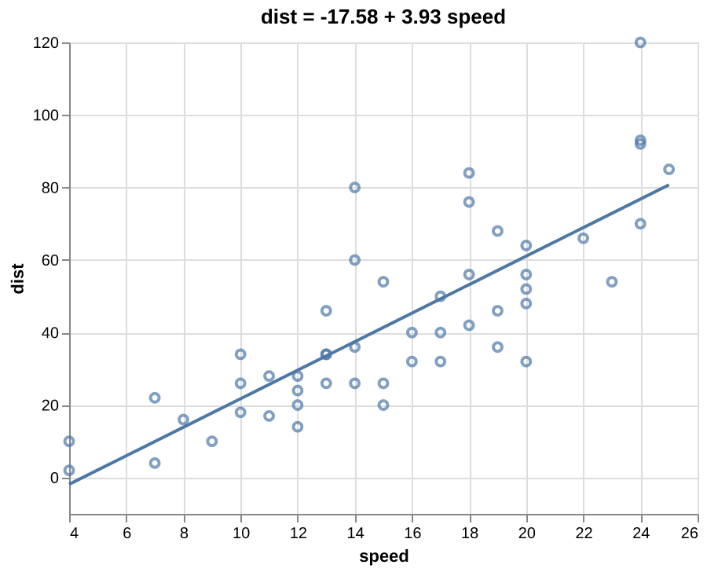
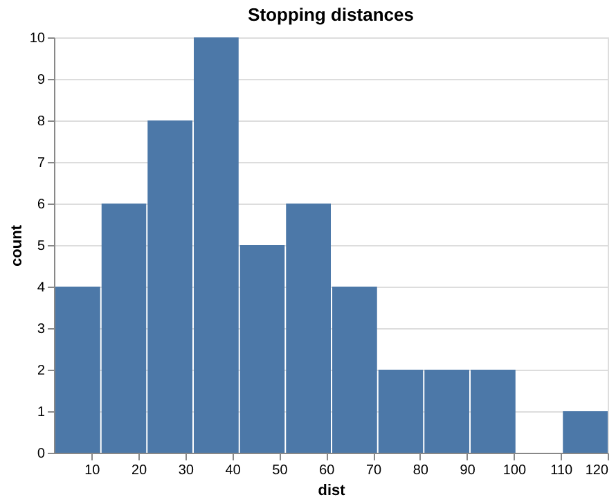
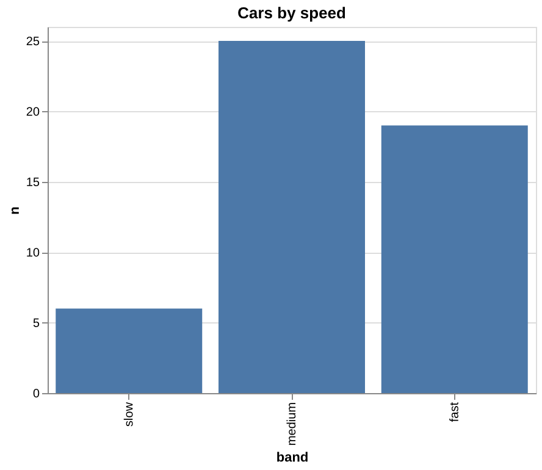
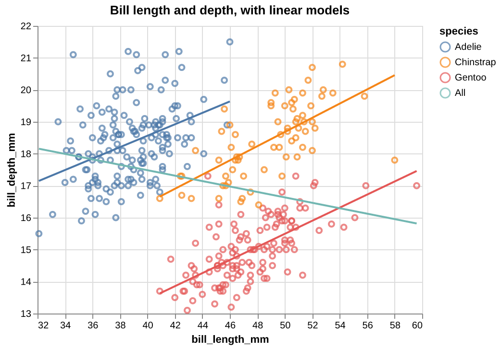
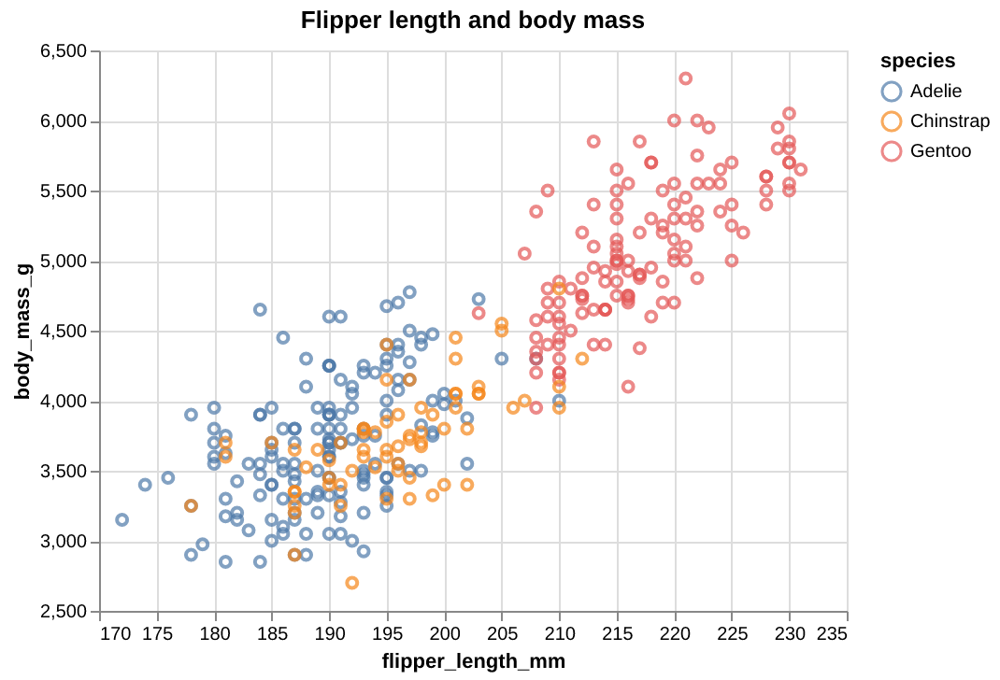
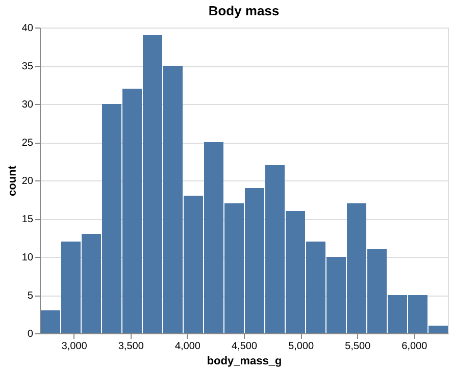

* bjostat-plot — charts of bjostat's tables

The package ~(bjostat plot)~ makes charts of the tables of [[https://github.com/bjoli/bjostat][bjostat]] as
[[https://vega.github.io/vega-lite/][Vega-Lite]] specifications, and saves them as JSON, or as SVG, PNG or PDF.

#+BEGIN_SRC scheme
(import (bjostat plot chart))
(import (bjostat plot save))

(def (Ok c) (scatter-plot cars "speed" "dist" #:title "Stopping distance") :propagate)
(save-chart c "cars.svg")
#+END_SRC

R's ~cars~, the points and the line of a linear model of ~(bjostat models)~
through them, as ~examples/cars.bjo~ draws it:

** Charts: (bjostat plot chart)

| Function | What it draws |
|----------+---------------|
| ~(scatter-plot t x y #:color c)~ | A point for each row; x and y are numbers or times |
| ~(line-plot t x y #:color c)~ | A line through the rows in the order of x; a line for each value of ~c~ |
| ~(bar-plot t x y #:color c)~ | A bar for each row, as ~table-count~ or ~groups->table~ makes them |
| ~(histogram t x #:bins 30)~ | The counts of a column of numbers in bins of one width |
| ~(layer [c1 c2 ...])~ | The charts drawn on one another: points and the line of a model |
| ~(chart-title c s)~, ~(chart-size c w h)~ | A title, and the size in pixels |
| ~(chart->json c #:indent 0)~ | The Vega-Lite specification, as text |

Each also takes ~#:title~, and the charts of rows ~#:max-rows~.

*Types.* A chart takes the names of columns, and the Vega-Lite type of each
comes from its type in the table: a number is quantitative, a string or a
bool nominal, a category nominal in the order of its levels, and a date or a
time temporal. A column a chart cannot use, as strings on the x of a
scatter plot, is an ~Err~ when the chart is made, as is a column the table
does not have.

*Scales.* The scale of a number on a scatter or line chart fits its values
and does not start at 0, as R draws them; the bars of a bar chart and a
histogram start at 0.

*Size.* The rows of the columns a chart uses go into its specification, and
Vega-Lite draws each. A chart of more rows than ~#:max-rows~, 5000 by
default, is an ~Err~ rather than a file of a million points: aggregate the
table first, or give ~#:max-rows~. A histogram counts its bins here, so it
holds the bins, whatever the number of rows.

** Saving: (bjostat plot save)

~(save-chart c path)~ writes the specification to a path ending in ~.json~,
and an image to one ending in ~.svg~, ~.png~ or ~.pdf~. The image is drawn by
[[https://github.com/vega/vl-convert][vl-convert]], a program with Vega in it that needs no browser and no Node:
install it with ~cargo install vl-convert --locked~, or take a release's
binary, and have it on the ~PATH~. Without it, an image is an ~Err~ that
says so, and the specification still is written.

~save-chart~ waits for vl-convert, so a bjoroutine that calls it parks its
thread, as the compiler warns.

** An example

~examples/cars.bjo~ draws R's ~cars~: the points with the line of a linear
model of ~(bjostat models)~ through them, a histogram of the distances, and
the counts of bands of speed, a category in its order.

#+BEGIN_SRC sh
bjo run examples/cars.bjo /tmp
#+END_SRC

|  |  |

The images in ~docs/~ are of the specifications it writes, drawn by
vl-convert 1.9.0 at twice their size.

** An example: the Palmer penguins

~examples/penguins.bjo~ ports the steps of two R tutorials of the Palmer
penguins, [[https://www.r-bloggers.com/2020/07/basic-data-analysis-with-palmerpenguins/][Basic data analysis with palmerpenguins]] (R-bloggers, 2020) and
[[https://education.rstudio.com/blog/2020/07/palmerpenguins-cran/][Release the penguins]] (RStudio Education, 2020). The data are 344 penguins
of three species on three islands of the Palmer Archipelago, Antarctica,
measured by Dr. Kristen Gorman from 2007 to 2009 ([[file:examples/data/README.org][examples/data]]).

#+BEGIN_SRC sh
bjo run examples/penguins.bjo examples/data/penguins.csv /tmp
#+END_SRC

R writes a missing value as ~NA~, so the file is read with ~#:nulls~, and
the columns of text are categories, as R's factors:

#+BEGIN_SRC scheme
(read-csv path #:nulls ["NA"]
               #:types [(Tuple "species" Category) (Tuple "island" Category) (Tuple "sex" Category)])
#+END_SRC

| Step | R | bjostat |
|------+---+---------|
| A summary of each column | ~summary(penguins)~ | ~table-summary~ |
| The species on each island | ~table(species, island)~, ~chisq.test~ | ~table-crosstab~, ~chi-squared-test~ |
| Flipper length and body mass | ~cor.test~ | ~correlation-test~ |
| Are males heavier? | ~t.test(body_mass_g ~ sex)~ | ~welch-t-test~ |
| Body mass by flipper and species | ~lm~, ~anova~ | ~with-categories linear-model~, ~model-anova~ |
| Bill length and depth | ~lm~ of all, and of each species | ~simple-linear-model~, by ~grouping~ |

Each test and model leaves out the rows with a null in its columns, as R's
~na.omit~ does, by ~complete-rows~:

#+BEGIN_SRC scheme
(loop (:for (Tuple f m) (complete-rows (Tuple flipper mass)))
      (:acc (correlation-test (Tuple (cast double f) (cast double m)))))
#+END_SRC

The model of body mass:

#+BEGIN_SRC text
Coefficients:
                  Estimate Std. Error t value Pr(>|t|)
(Intercept)          -4031      584.2  -6.901 2.55e-11
flipper_length_mm    40.71      3.071   13.25   <2e-16
speciesChinstrap    -206.5      57.73  -3.577 0.000398
speciesGentoo        266.8      95.26   2.801  0.00539
#+END_SRC

A Gentoo penguin is 267 g heavier than an Adelie with flippers of the same
length, and a Chinstrap 207 g lighter.

Bills show Simpson's paradox. Of all the penguins, a bill 1 mm longer is
on average 0.085 mm shallower. Of each species, it is about 0.2 mm deeper:

#+BEGIN_SRC text
All: depth = 20.885 - 0.085 × length
Adelie: depth = 11.409 + 0.179 × length
Chinstrap: depth = 7.569 + 0.222 × length
Gentoo: depth = 5.251 + 0.205 × length
#+END_SRC

Gentoo penguins have long and shallow bills, and Adelie penguins short and
deep ones, so the line of all the penguins falls where each species' line
rises.

|  |  |

The tutorials also draw boxplots, a matrix of all the scatter plots, and
charts by facets; ~(bjostat plot)~ does not draw these yet.

** Tests

#+BEGIN_SRC sh
bjo run tests/chart.bjo    # every line starts with "ok:"
#+END_SRC

The specifications of the example were drawn by vl-convert 1.9.0, as SVG
and as PNG, and look as they should.

** License

MPL-2.0, as bjostat.
